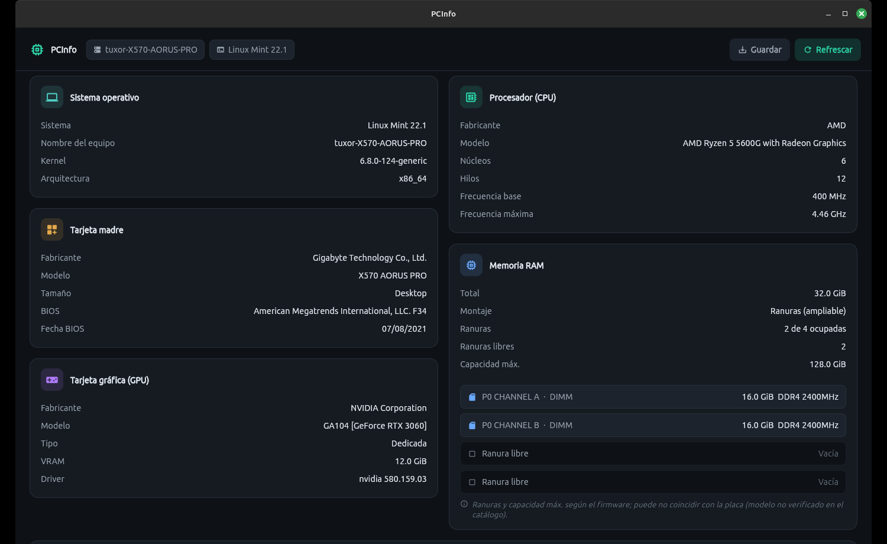
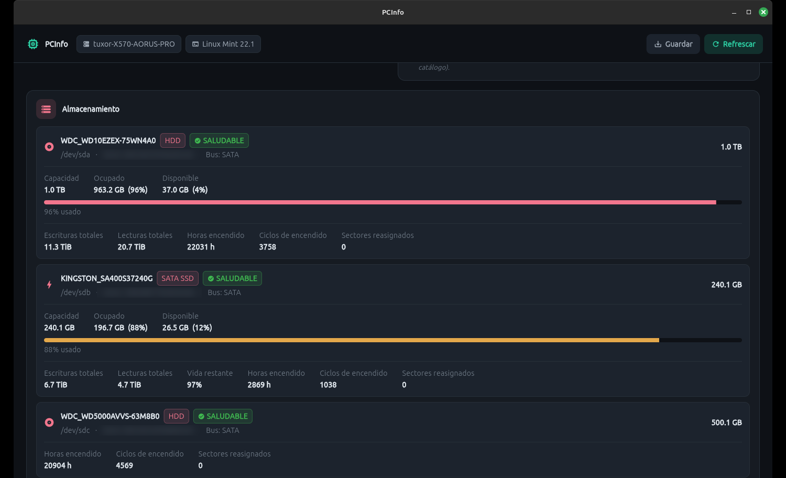

# PCInfo

[](https://www.gnu.org/licenses/gpl-3.0)
[](mailto:tuxor.max@gmail.com)
[](https://github.com/tuxormax/pcinfo/releases/latest)

## Descargar

### [Ver todas las descargas (Windows, Linux)](https://github.com/tuxormax/pcinfo/releases/latest)

Instalador de Windows, portable de Windows y paquete `.deb` de Linux, siempre con la última versión arriba.

---

App de **inventario de hardware** multiplataforma (**Linux** y **Windows**): CPU, tarjeta madre, RAM, GPU, almacenamiento y sistema operativo. Sin temperaturas — solo información del equipo.

Además de lo que hay puesto, dice **qué sitio queda libre**: cuántos conectores **SATA** trae la placa y cuántos siguen vacíos, qué ranuras **M.2** y **PCIe** tiene y cuáles están ocupadas, y **en qué puerto está enchufado cada disco**. Así se sabe si al equipo le cabe otro disco o una tarjeta sin abrir el gabinete. Los datos salen de un catálogo de placas verificado contra la hoja del fabricante y, cuando la placa no está catalogada, del firmware — diciéndolo.

Incluye además la pestaña **Historial de Errores**: lee lo que registró el sistema operativo (pantallazos azules y registro de eventos en Windows; journald y mensajes del kernel en Linux) y lo explica en español — qué pasó, qué lo provocó (incluido el **driver culpable** deducido del volcado de memoria en los BSOD) y cómo resolverlo.

Y dos pestañas más:

- **Software** — todos los programas instalados con su versión, separando **lo que instaló el usuario** de **lo que vino con el sistema**. Se exporta ya agrupado, listo para pegar en un informe o un ticket.
- **Controladores** *(solo Windows)* — **respaldar y restaurar** los controladores de terceros del equipo y las **redes WiFi guardadas** (con sus contraseñas). Pensado para formatear un equipo sin perder ni los drivers ni las claves del WiFi.

En todas las pestañas, el botón **Guardar** pregunta dónde dejar el archivo y escribe un **Markdown** (`.md`): se lee igual que un texto plano en cualquier editor, y pegado en un ticket, un correo o un repositorio conserva sus títulos y sus tablas.

> **En desarrollo.** Reescritura completa del antiguo *LinuxHWMonitor* (Python + PyQt5) a una arquitectura **Go + Flutter**.

## Capturas



*Sistema operativo, procesador, tarjeta madre, RAM (ranuras ocupadas y libres) y tarjeta gráfica.*



*Almacenamiento con estado de salud S.M.A.R.T., uso del disco, vida restante en SSD, horas encendido y sectores reasignados.*

## Descargar e instalar

Los archivos están en **[Releases](https://github.com/tuxormax/pcinfo/releases/latest)** (`PCInfo-Linux.deb`, `PCInfo-Windows-Instalador.exe`, `PCInfo-Windows-Portable.zip`). Cómo se instala cada uno:

| Sistema | Cómo se instala |
|---|---|
| **Linux** (Debian/Ubuntu/Mint) | `sudo apt install ./PCInfo-Linux.deb` |
| **Windows 10 u 11** (64 bits) | Doble clic al instalador y seguir el asistente |
| **Windows portable** | Descomprimir el `.zip` y abrir `pcinfo.exe` — no instala nada, sirve desde una USB |

Los instaladores **no se guardan en el repositorio** (son binarios pesados): viven en **Releases**, un release por revisión y sin borrar los anteriores. Cada release trae además los mismos archivos **con la versión en el nombre** (`pcinfo_v1.6_rev-38.exe`), que son los útiles cuando alguien te manda uno y hay que saber de qué revisión es.

Notas:

- En Windows el requisito mínimo es **Windows 10**; Windows 7 y 8 no son compatibles.
- La lectura de salud S.M.A.R.T. de los discos pide permisos de administrador/root; el resto del inventario funciona sin ellos.
- La pestaña **Controladores** necesita administrador entera (respaldar y restaurar escriben en el sistema). Si PCInfo no lo tiene, la propia pestaña ofrece el botón *Reintentar como administrador*.
- ¿Prefieres compilarlo tú mismo? Ver **[herramientas/construir/LEEME.md](herramientas/construir/LEEME.md)**.

## Diagnosticar un equipo que ya no arranca

La versión **portable** cabe en una memoria USB y sirve para revisar un equipo que no entra a Windows:

1. Arranca el equipo con un medio de rescate en modo live (**Hiren's BootCD PE** o cualquier WinPE).
2. Abre `pcinfo.exe` desde la USB.
3. En la pestaña **Historial de Errores**, el selector *«Analizando el Windows de:»* lista las instalaciones encontradas en los discos. Elige la del Windows averiado — normalmente `C:` o `D:`, no la unidad del medio de rescate.

PCInfo lee entonces **sus** registros de eventos y **sus** volcados de pantallazo azul aunque ese Windows no pueda arrancar, deduce el driver culpable a partir del volcado y explica qué pasó y cómo resolverlo. Al analizar una instalación apagada se revisan los últimos **180 días** en lugar de 30, porque un equipo averiado suele llevar semanas sin usarse. Con **Guardar** queda un `.md` con todo el diagnóstico.

La pestaña *Hardware* sigue funcionando en ese escenario y muestra el hardware real del equipo (el sistema operativo que reporta es el del medio de rescate).

## Recopilador de pantallazos azules (Windows)

El instalador de Windows deja puesta la herramienta **bluescreen**, que captura **cada pantallazo azul en cuanto ocurre** — la app, en cambio, solo mira hacia atrás cuando la abres.

- Registra la tarea `RecopilarBluescreens`, disparada por el propio pantallazo (evento 1001) y, de respaldo, al arrancar. Corre como SYSTEM.
- Va acumulando todos los fallos en **`C:\bluescreen.md`**, cada uno con su sección **CAUSANTE DEL ERROR**: qué driver lo causó, por qué se le señala y cómo resolverlo. Es el mismo análisis del volcado que usa la pestaña *Historial de Errores*, así que los dos señalan siempre al mismo culpable.
- Sobre todo, **garantiza que Windows llegue a crear el volcado**: deja el volcado pequeño configurado (`CrashDumpEnabled = 3`), sube el histórico a 50 minidumps y se asegura de que el archivo de paginación esté administrado por el sistema. Sin eso el pantallazo no deja `.dmp` y no hay nada que analizar — en un caso real, de 32 pantallazos solo sobrevivieron 5 volcados.

En el menú Inicio queda como **Pantallazos azules (bluescreen)**, con opciones para ver el informe, regenerarlo o quitar la tarea. Al desinstalar PCInfo la tarea se quita; el `C:\bluescreen.md` **se conserva**.

## Respaldar y restaurar controladores y redes WiFi (Windows)

Antes de formatear un equipo, la pestaña **Controladores** guarda lo que Windows no vuelve a poner solo:

1. **Respaldar controladores** — copia los controladores de terceros instalados (`Export-WindowsDriver`) a la carpeta que elijas, en una subcarpeta `Controladores`. Puede tardar varios minutos; el avance se ve línea a línea.
2. **Respaldar redes WiFi** — exporta los perfiles inalámbricos con **sus contraseñas** a la subcarpeta `RedesWiFi`.
3. Tras reinstalar Windows, **Restaurar controladores** los instala uno a uno (`pnputil`) y **Restaurar redes WiFi** vuelve a dejar el equipo conectándose solo a las redes conocidas.

> ⚠️ Los archivos `.xml` del respaldo de WiFi contienen las contraseñas **en texto legible**: es lo único que permite restaurarlas en otro equipo sin teclearlas. Guarda esa carpeta donde corresponda.

La carpeta se elige **siempre a mano** (lo normal es que el respaldo vaya a una USB) y restaurar pide confirmación explícita diciendo qué va a pasar. En Linux la pestaña avisa de que no aplica: ahí los controladores vienen en el kernel y los gestiona la distribución.

## Arquitectura

- **`pcinfo/`** — interfaz gráfica en **Flutter** (desktop Linux/Windows), con cuatro pestañas: *Hardware*, *Historial de Errores*, *Software* y *Controladores*.
- **`backend/`** — recolector en **Go** que expone por HTTP local (JSON) el inventario (`GET /hardware`), el historial de errores (`GET /errores`, con `?raiz=D:\Windows` para analizar otra instalación), el software instalado (`GET /software`) y los controladores y redes WiFi (`GET /controladores`, más `POST /controladores/{respaldar,restaurar}` y `GET /controladores/tarea` para seguir el avance). Usa `ghw` (inventario), `smartctl` (salud S.M.A.R.T. de discos), `nvidia-smi` (GPU), el registro de Windows y `Get-AppxPackage` (software), `Export-WindowsDriver`/`pnputil`/`netsh wlan` (controladores y redes), el registro de eventos de Windows y journald/dpkg/rpm en Linux.

La GUI consume el JSON del backend; la misma base de código sirve para Linux y Windows.

## Requisitos de desarrollo

- Flutter 3.35+ con desktop habilitado (`flutter config --enable-linux-desktop`).
- Go 1.26+ (para el backend).

## Ejecutar la GUI

```bash
cd pcinfo
flutter run -d linux
```

## Autor

**Creado por:** tuxor · tuxor.max@gmail.com

> Si usas, modificas o distribuyes este software, los créditos del autor original deben mantenerse visibles tanto en el código fuente como en la interfaz del programa. Lo exige la licencia GPL v3.

## Licencia

GNU General Public License v3.0 — ver [LICENSE](LICENSE).
